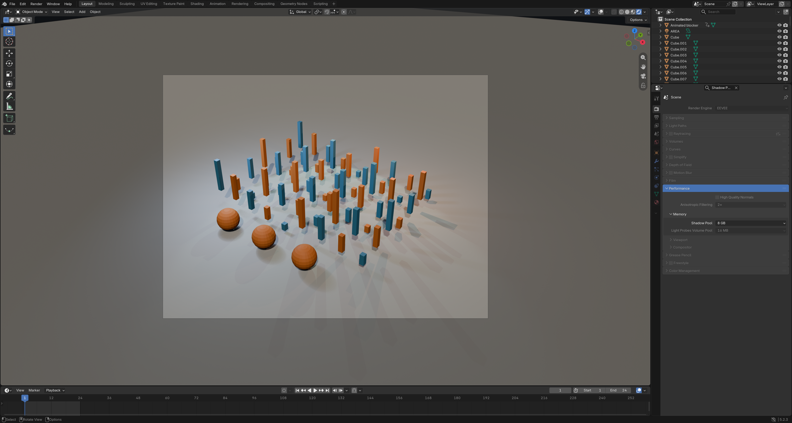

# Blender EEVEE 8 GiB 阴影池

**基于 Blender 5.2.3 LTS 的非官方 Windows x64 便携构建。** 将 EEVEE 阴影池扩展到 8 GiB，用于缓解复杂场景中的 `Shadow buffer full` 问题。

本项目不隶属于 Blender Foundation，也不代表 Blender 官方发布或支持。Blender 的名称和相关标识属于其各自权利人。

[下载 Windows 便携版](../../releases/latest) · [构建说明](docs/BUILD.md) · [测试记录](docs/VALIDATION.md) · [许可与来源](NOTICE.md)

## 主要改动

| 项目 | 官方基线 | 本构建 |
| --- | --- | --- |
| 最大阴影池 | 2 GiB | 8 GiB |
| 最大物理页数 | 8,192 | 32,768 |
| 图集最大层数 | 128 | 512 |
| 阴影页尺寸 | 256 × 256 | 保持不变 |

新增 **4 GB**、**8 GB** 菜单选项，原有较小容量档位保留。启动器首次建立的新配置默认使用 EEVEE 和 8 GB 阴影池；已有 `.blend` 文件保留自己的设置。

这项改动包含页地址、缓存索引及采样数据的位布局调整，并非仅增加界面选项。8 GB 档位实际为 **8,589,934,592 字节（8 GiB）**。它增加的是阴影存储容量，不会自动提高分辨率、灯光数量上限或帧率，也不会改变 Cycles 的阴影系统。

## 下载与使用

1. 在 [Releases](../../releases) 下载 `Blender-5.2.3-Shadow8GB-Windows-x64-v1.0.0.zip`。
2. 完整解压到可写目录，双击根目录的 **Start-Blender.cmd**。
3. 在 **Render Properties → Performance → Memory → Shadow Pool** 选择所需容量。

首次启动不需要下载运行依赖。配置、临时文件及主要缓存保存在包内 `profiles` 目录；不更改系统文件关联和全局环境变量。请优先通过启动器运行。

**8 GB 阴影池本身就需要 8 GiB 显存，模型、贴图与其他渲染数据还需要额外空间。** 8 GB 显卡不等于能够使用 8 GB 阴影池；空闲显存不足时请选择较小档位。当前验证硬件是 NVIDIA RTX 4090 24 GB，其他显卡尚未验证。

## 验证结果

- OpenGL、Vulkan 共 **22 项阴影单元测试全部通过**。
- 实际分配 2048 × 2048 × 512 的阴影图集，共 32,768 页。
- 96 盏太阳灯压力场景占用 **14,554 页**：原版 2 GB 报容量不足，8 GB 构建完成渲染。
- 普通合成场景的第 1、12、24 帧及返回第 1 帧完成渲染；OpenGL 下与官方基准逐像素一致。
- Rendered 视口和原生 4 GB / 8 GB 菜单已截图检查。
- 便携包已在另一目录解压运行，检查配置隔离与实际渲染。

这些结果针对合成测试场景，不代表所有真实项目、第三方插件、显卡或长时间动画均已验证。Vulkan 与 OpenGL 存在轻微图像差异，详见[测试记录](docs/VALIDATION.md)。

## 源码与复现

- [`blender/`](blender/)：完整修改后源码，保留上游目录结构与许可声明。
- [`patches/shadow-pool-8gb.patch`](patches/shadow-pool-8gb.patch)：相对于上游的完整差异。
- [`Build-Windows.cmd`](Build-Windows.cmd)：Windows 构建入口；依赖准备见[构建说明](docs/BUILD.md)。
- [`launcher/`](launcher/)：便携启动器源码。
- [`verification/`](verification/)：测试数据、文件哈希与解压复测结果。

上游版本为 `v5.2.3`，提交为 `e13b728c6880d3084d9d57c30031ed5df8b39dee`。运行时代码修改日期为 2026-10-23；2026-10-24 补充公开发布文档和源码修改说明，程序二进制未改变。

每个 Release 同时提供完整对应源码归档、补丁和 SHA-256 校验文件；便携 ZIP 内也包含对应源码。GitHub 自动生成的仓库源码归档不含预编译 Windows 程序。

## 许可与致谢

本发行版按 **GNU GPL v3.0 或更高版本**提供。Blender 原有源文件、测试及第三方组件保留各自许可，不统一改写其 SPDX 声明。新增便携启动脚本按 GPL-3.0-or-later 提供。见 [LICENSE](LICENSE)、[NOTICE.md](NOTICE.md) 及程序包 `app/license`。

Blender 由 Blender Foundation 和 Blender 社区开发。本项目仅对阴影池及相关地址、缓存和验证代码作修改。再分发时请保留对应源码、修改说明、版权声明和许可证，并清楚标注非官方版本。

## English summary

An **unofficial Windows x64 build of Blender 5.2.3 LTS** extending the EEVEE shadow pool to **8 GiB / 32,768 physical pages**. Includes 4 GB and 8 GB settings, matching address/cache packing changes, portable launchers, complete corresponding source, and validation results. Tested on an NVIDIA RTX 4090 24 GB with OpenGL and Vulkan. The shadow atlas alone requires 8 GiB of VRAM; additional memory is needed for the scene. This project is not affiliated with or endorsed by the Blender Foundation. See [NOTICE.md](NOTICE.md) for licensing and provenance.
