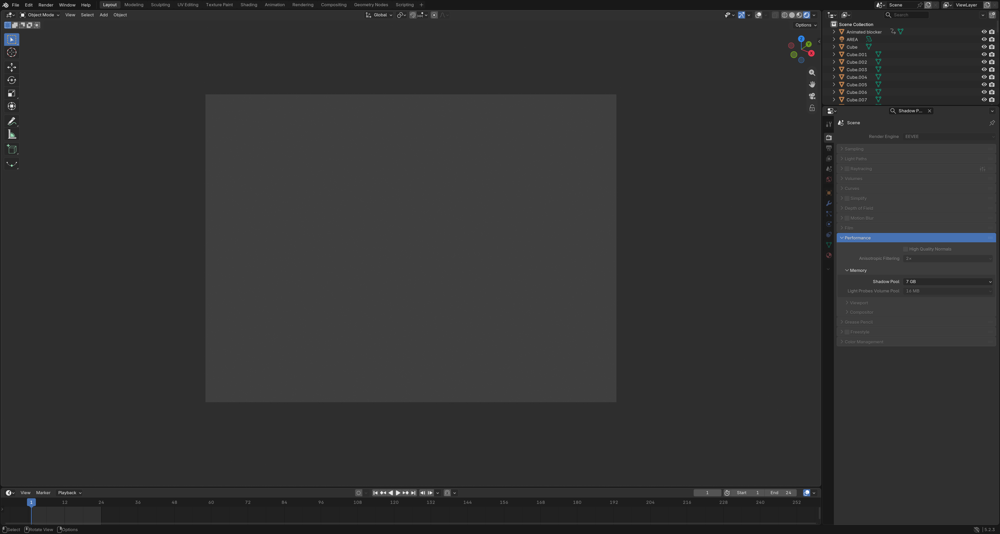
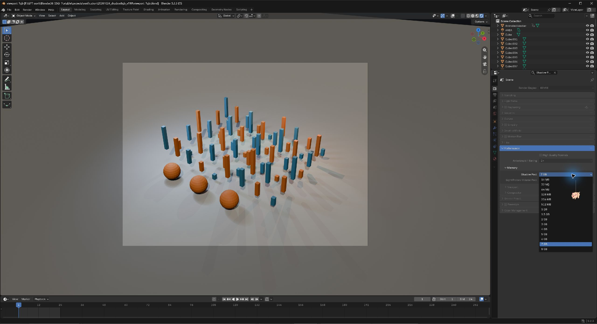

# v1.1.0 档位更新验证（2026-10-24）

新增 3、5、6、7 GB，提供 2–8 GB 每 1 GiB 一档；默认 8 GB。程序 SHA-256：`d7de184f07f8a6ca00a4ebb580683703af24645da5c317231c72ed9349851c77`。

测试平台：Windows x64，NVIDIA RTX 4090 24 GB。OpenGL 与 Vulkan 分别完成 2→3→4→5→6→7→8→2 GB 的八次场景保存、重新打开及实际渲染，合计 16 次，全部通过。同后端各容量的普通场景 PNG 与该后端 2 GB 参考逐像素一致。

每档图集均成功实际分配，页数为 GiB × 4096，层数为 GiB × 64，字节数为 GiB × 1,073,741,824。默认值保持 8192 MiB。22 项阴影单元测试再次全部通过。详情见 verification/v1.1.0-tiers.json（便携包为 Verification/v1.1.0-tiers.json）。

本次修改仅为容量枚举，最大容量、页地址与缓存算法沿用 v1.0.0。此前 v1.0.0 的 96 灯压力场景结果保留为历史验证，本次没有重新跑该压力场景，也未对所有显卡、插件或真实项目作全面验证。

8 GB 阴影池之外仍需要额外场景显存。新增档位便于选择预算，不增加图像分辨率或保证性能提升。

[v1.0.0 历史验证](VALIDATION-v1.0.0.md)
